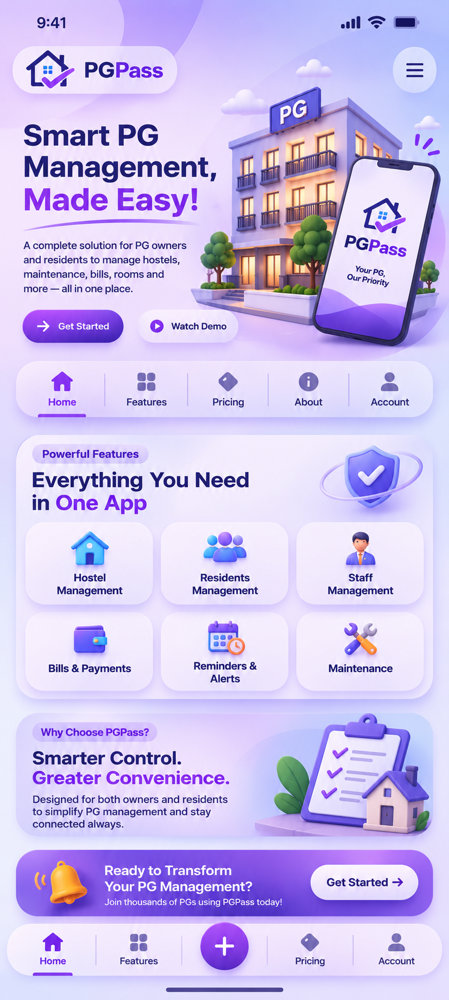
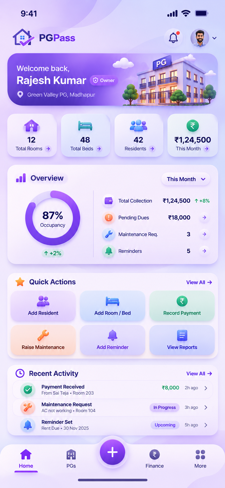
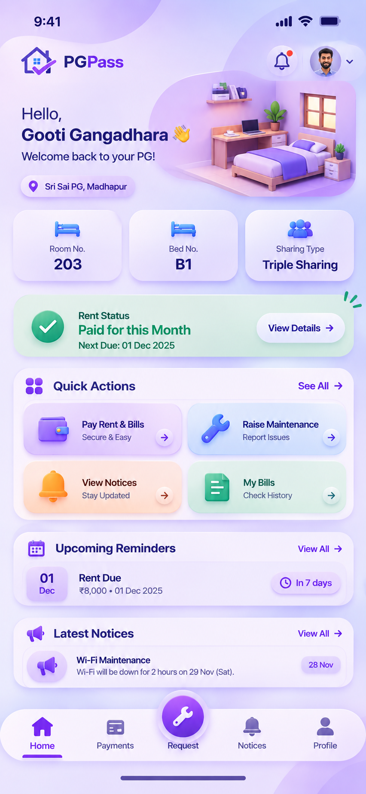
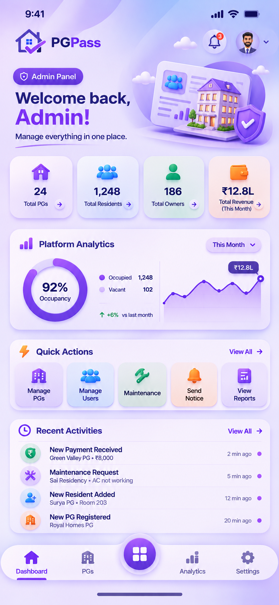

<div align="center">

# 🏠 PGPass

### Smart PG & Hostel Management — Made Easy

**Manage beds, residents, rent, deposits, staff and more in one place — with zero platform fees.**
Mobile-first. Multi-tenant. Built for India. Runs at **₹0** on free tiers.

<br/>



</div>

---

## ✨ What is PGPass?

PGPass helps PG and hostel **owners** run their property end-to-end — rooms, beds, residents,
rent, deposits, expenses, maintenance and staff — while **residents** get a clean self-service
portal and **admins** oversee the whole platform. Payments go **directly owner-to-resident via
UPI** (0% fees), so no one pays transaction charges.

> **The product must be dependable before it is beautiful, and useful before it is monetized.**

---

## 📱 The App

<table>
<tr>
<td width="33%" align="center"><b>Owner Console</b></td>
<td width="33%" align="center"><b>Resident Portal</b></td>
<td width="33%" align="center"><b>Admin Panel</b></td>
</tr>
<tr>
<td></td>
<td></td>
<td></td>
</tr>
<tr>
<td>Live occupancy & collection stats, bed grid, rent, deposits, expenses, staff.</td>
<td>Rent status, pay via UPI, deposit, raise issues, notices — all from a secure link.</td>
<td>Cross-PG oversight, per-PG features, support chat, reviews, system logs.</td>
</tr>
</table>

---

## 🎯 Features

| For Owners | For Residents | For Admins |
|---|---|---|
| 🛏️ Bed & room inventory | 🔑 Secure portal (link + PIN) | 🏢 Platform-wide overview |
| 👥 Resident lifecycle | 💳 Pay rent via direct UPI | ⚙️ Per-PG feature flags |
| 💰 Rent, partial payments, receipts | 📄 Deposit & rent history | 💬 Owner support chat |
| 🏦 Deposit ledger & refunds | 🛠️ Raise maintenance issues | ⭐ Review moderation |
| 📊 Analytics & defaulter aging | 🔔 Notices & reminders | 📋 System log viewer |
| 🧾 Expenses & net revenue | 🏘️ Discover & review PGs | 🔐 Suspend / reactivate accounts |
| 👷 Staff with granular permissions | | |

**Also:** short-stay guests · multi-property · PG discovery directory · WhatsApp rent
reminders · HRA PDF receipts · single active session · idle auto-logout.

---

## 🧱 Tech Stack

| Layer | Choice |
|---|---|
| **Framework** | Next.js 16 (App Router) · React 19 |
| **Language** | TypeScript (strict) |
| **Styling** | Tailwind CSS v4 — per-role theming |
| **Auth** | Firebase Auth (Google · Email · Phone) |
| **Database** | Cloud Firestore |
| **Storage** | Backblaze B2 (private photos, S3 API) |
| **Validation** | Zod |

**Principles:** server-only writes · strict tenant isolation · money in integer paise ·
soft-delete (never destroy financial history) · append-only audit · ₹0 mandatory cost.

---

## 🚀 Getting Started

```bash
# 1. Install
npm install

# 2. Configure env (copy a template and fill it in)
cp .env.development.example .env.development

# 3. Run (local emulators optional)
npm run emulators   # Firebase Auth + Firestore emulators
npm run dev         # → http://localhost:3000
```

### Quality gates

```bash
npm run typecheck   # tsc --noEmit
npm run lint        # eslint
npm test            # vitest unit tests
npm run build       # production build
```

---

## 📂 Project Structure

```
app/            Routes + API (owner · resident · admin · tenant portal)
components/     UI design system + feature components
lib/
  server/       Server-only: services, auth, security, storage, monitoring
  client/       Browser helpers (upi, qrcode, receiptPdf, uploader…)
  constants/    Limits, permissions, routes, status
hooks/          useAuth · useOwner · useBeds · useTenants
docs/           Architecture, blueprint, runbook, data inventory, issues
```

---

## 📖 Documentation

All docs live in [`docs/`](docs/):

- **[architecture-spec.md](docs/architecture-spec.md)** — what exists today (the source of truth)
- **[product-blueprint.md](docs/product-blueprint.md)** — product principles, scope & test matrix
- **[runbook.md](docs/runbook.md)** — incident response
- **[data-inventory.md](docs/data-inventory.md)** — DPDP data map
- **[ISSUES.md](docs/ISSUES.md)** — issue & bug log

> **[`AGENTS.md`](AGENTS.md)** stays in the root (the agents.md convention AI tools auto-discover)
> — mandatory engineering rules for every contributor and AI agent.

---

<div align="center">

**Built for Indian PG owners — dependable, mobile-first, and free at its core.**

</div>
